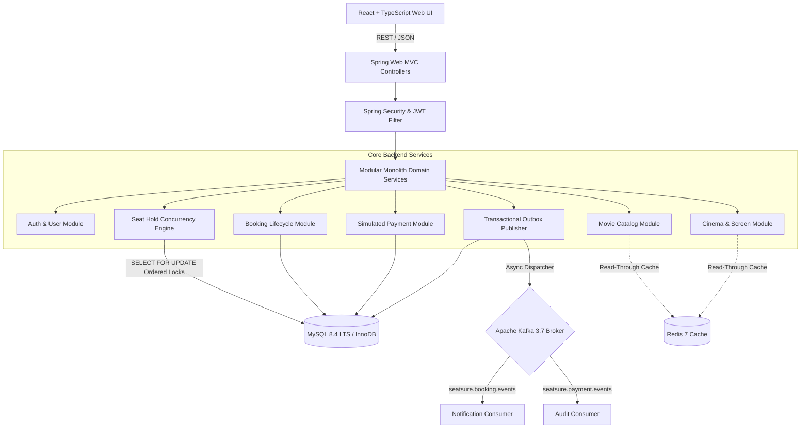
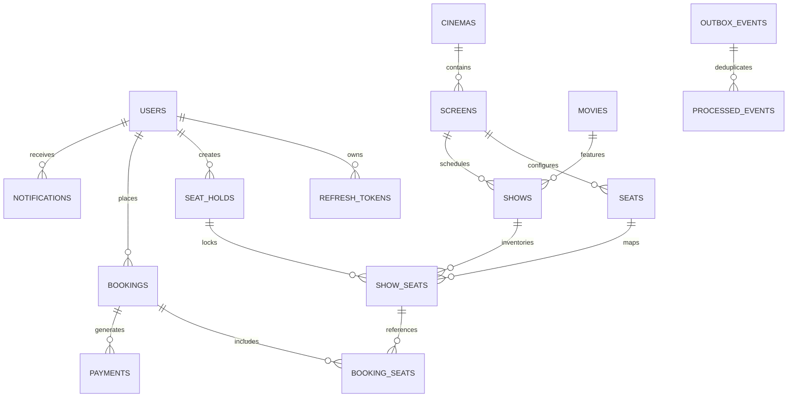
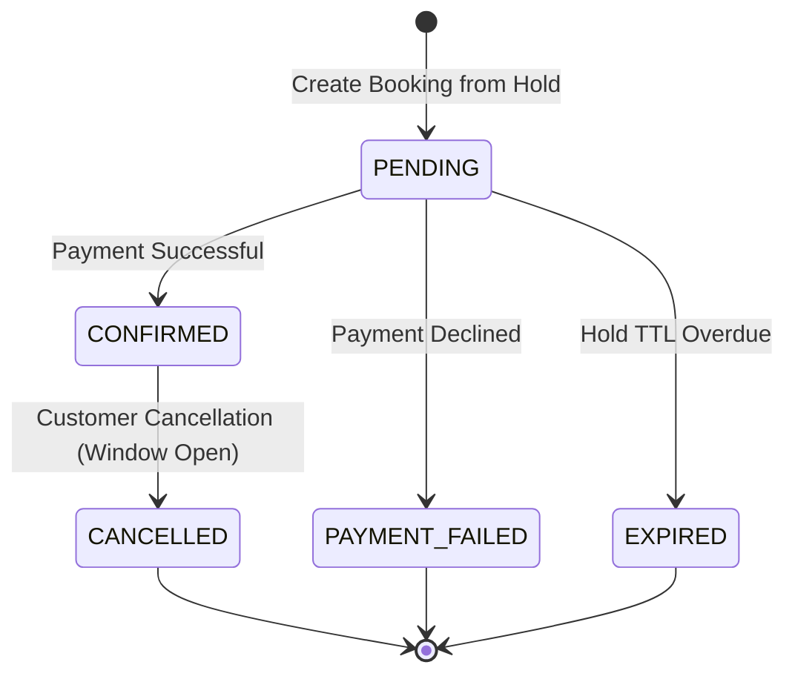
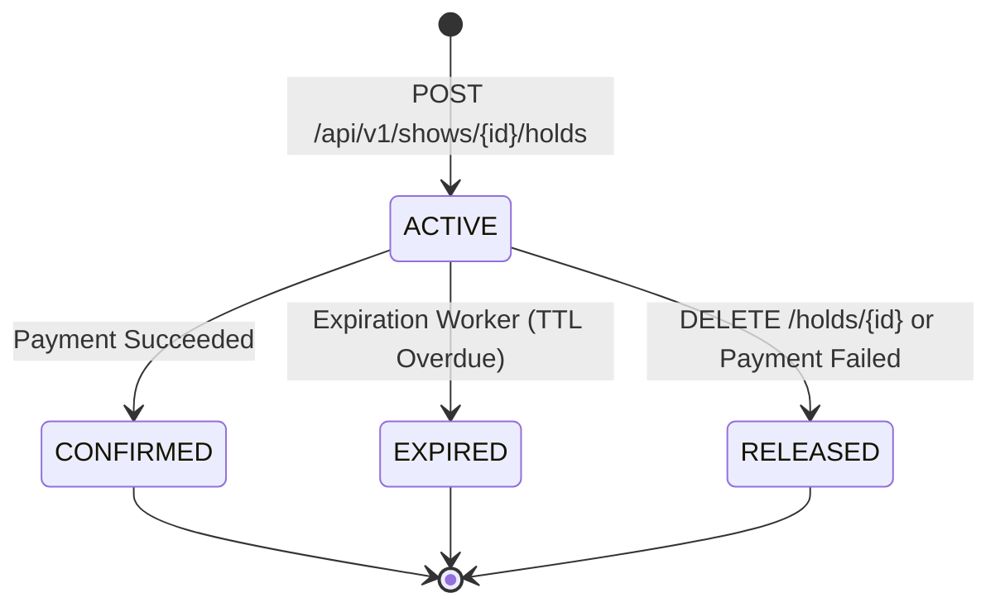
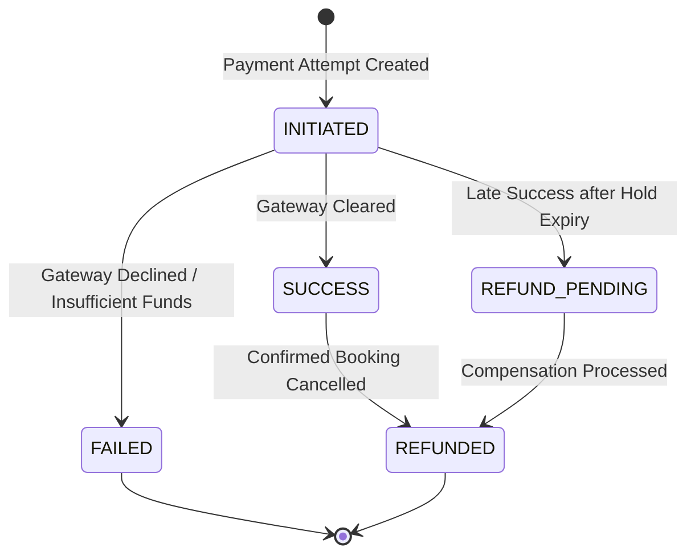

# SeatSure — Production-Grade Ticket Booking Platform

[](https://www.oracle.com/java/)
[](https://spring.io/projects/spring-boot)
[](https://www.mysql.com/)
[-black.svg)](https://kafka.apache.org/)
[](https://react.dev/)
[](https://vitejs.dev/)

> **SeatSure** is an enterprise-grade ticket booking platform inspired by BookMyShow. It features database-backed concurrency controls against double-booking, temporary seat hold expiration, an idempotent simulated payment system, a transactional outbox with Apache Kafka, role-based JWT authentication, and a responsive cinematic dark-themed web UI.

---

## 1. Project Overview
SeatSure is designed as a **modular monolith** with clean aggregate boundaries, deterministic concurrency protection, and decoupled domain messaging. It solves the hardest problems in high-contention e-commerce:
- **Zero Double-Booking Guarantee**: Pessimistic row-level locking (`SELECT ... FOR UPDATE`) ordered by physical seat ID prevents race conditions and cyclic deadlocks.
- **Temporary Seat Holds**: Reserving seats grants a 5-minute hold with live countdown timer and automated background recovery.
- **Safe Compensation Policy**: Late payment confirmations after hold expiration trigger automatic simulated refunds rather than confirming an unavailable seat.
- **Transactional Outbox & Consumer Deduplication**: Guarantees at-least-once message delivery to Kafka with idempotent processing.

---

## 2. Feature List

### Customer Capabilities
- **City & Cinema Discovery**: Discover multiplexes and upcoming screenings across Mumbai, Bengaluru, Delhi NCR, and Hyderabad.
- **Movie Catalog Filtering**: Search by title, genre, and language.
- **Interactive Theater Map**: Visual curved screen projection with tiered seats (Silver, Gold, Platinum/VIP).
- **Real-Time Seat Holds**: Hold up to 8 seats simultaneously with live countdown timer.
- **Simulated Payment Gateway**: Test UPI, Credit Card, and Net Banking with deterministic outcomes (SUCCESS, FAILURE, TIMEOUT).
- **M-Ticket Confirmation**: Instant digital ticket with booking reference and simulated barcode.
- **Booking Management & Refunds**: View booking history and cancel tickets with automatic refund compensation.
- **Notification Center**: Real-time alerts for booking confirmations, cancellations, and refunds.

### Administrator Capabilities
- **Movie Catalog Management**: Add movies, update synopsis/runtimes, and toggle active status.
- **Screen & Seat Configuration**: Create screens and automatically generate tiered seat layouts.
- **Screening Scheduling**: Schedule shows with automated overlap conflict validation.
- **Audit Logging**: Structured operational audit logs with correlation details.

---

## 3. Technology Stack

| Layer | Technologies |
|---|---|
| **Backend** | Java 17 LTS (forward compatible with Java 21), Spring Boot 3.3.4, Spring Web MVC, Spring Data JPA / Hibernate, Spring Security 6, JJWT 0.12.6, Jakarta Bean Validation, Spring Boot Actuator |
| **Database** | MySQL 8.4 LTS (Production & Docker), Flyway versioned migrations, H2 (MySQL Mode for standalone local execution and fast integration testing) |
| **Messaging & Cache** | Apache Kafka 3.7 (KRaft mode), Spring Kafka, Redis 7 (Lettuce client with in-memory resilient fallback) |
| **Frontend** | React 18 / 19, TypeScript, Vite, React Router 6, Axios with token interceptor and refresh rotation, Lucide React icons, Vanilla CSS cinematic design |
| **DevOps & Containers** | Docker & Docker Compose, Multi-stage Dockerfiles, Nginx Alpine reverse proxy |

---

## 4. Architecture Diagram



---

## 5. Database ER Diagram



---

## 6. Booking Lifecycle State Machine



---

## 7. Seat-Hold Lifecycle State Machine



---

## 8. Payment State Transitions



---

## 9. Double-Booking Prevention & Concurrency Control
SeatSure enforces strict serializability on contested seat inventory:
1. **Deterministic Locking Order**: All requested seat IDs are sorted ascending (`ORDER BY seat_id ASC`) prior to issuing `SELECT ... FOR UPDATE`. This creates a global lock hierarchy that completely prevents cyclic deadlocks.
2. **Atomic Verification**: The transaction validates that all requested seats belong to the target show and currently have `status = 'AVAILABLE'`.
3. **Rollback on Any Conflict**: If any requested seat is already held or booked, the entire transaction rolls back and returns HTTP `409 Conflict` (`SeatUnavailableException`).
4. **Automated Concurrency Proof**: Verified by an automated integration test (`SeatHoldConcurrencyIntegrationTest.java`) executing 10 concurrent threads competing for the exact same seat at the same microsecond.

---

## 10. Transaction Boundaries
- Every database modification runs within an explicit `@Transactional(isolation = Isolation.READ_COMMITTED)`.
- No long-running network I/O or external API calls take place inside database transactions.
- Domain events are persisted to `outbox_events` within the same transaction that updates booking state.

---

## 11. Redis Caching Strategy & Fallback
- **Read-Through Cache**: Used for published movie catalogs (`movies`), cinema details (`cinemas`), and city listings (`cities`) with 10-15 minute TTLs.
- **Inventory Rule**: MySQL InnoDB is always the authoritative source of truth for seat availability. Redis is never used as final booking authorization.
- **Resilient Fallback**: If Redis is offline, SeatSure's `fallbackCacheManager` seamlessly routes requests through in-memory cache with zero downtime.

---

## 12. Kafka Event Flow & Consumer Groups
- **Topics**: `seatsure.booking.events`, `seatsure.payment.events`, `seatsure.seat.events`, `seatsure.booking.events.DLT`.
- **Partitioning Key**: `bookingId` or `showId` ensures strict in-order message delivery per aggregate.
- **Consumer Groups**: Independent consumer groups (`seatsure-notification-group`, `seatsure-audit-group`).
- **Deduplication**: Idempotent message consumption enforced via `processed_events` table.

---

## 13. Security Design
- **Stateless JWT**: Short-lived 15-minute access tokens and 7-day cryptographically random refresh tokens with automatic rotation.
- **Role-Based Access Control**: `ROLE_CUSTOMER`, `ROLE_ADMIN`, `ROLE_SYSTEM`. Admin endpoints are strictly protected by backend `@PreAuthorize("hasRole('ADMIN')")`.
- **Password Security**: BCrypt password hashing.
- **CORS Protection**: Restricted to configured frontend origins.

---

## 14. API Endpoint Summary

| Method | Endpoint | Description | Auth Required |
|---|---|---|---|
| `POST` | `/api/v1/auth/register` | Register new customer account | No |
| `POST` | `/api/v1/auth/login` | Login and obtain JWT tokens | No |
| `POST` | `/api/v1/auth/refresh` | Rotate refresh token & get new access token | No |
| `GET` | `/api/v1/users/me` | Current user profile | Customer / Admin |
| `GET` | `/api/v1/movies` | Discover movies with city, genre & search filters | No |
| `GET` | `/api/v1/movies/{id}/shows` | Get upcoming scheduled shows for a movie in a city | No |
| `GET` | `/api/v1/shows/{id}/seats` | Real-time seat layout & availability | No |
| `POST` | `/api/v1/shows/{id}/holds` | Acquire temporary hold on seats (concurrency safe) | Customer |
| `DELETE` | `/api/v1/holds/{id}` | Release seat hold back to inventory | Customer |
| `POST` | `/api/v1/bookings` | Convert active hold into pending booking | Customer |
| `GET` | `/api/v1/bookings` | User booking history | Customer |
| `POST` | `/api/v1/bookings/{id}/cancel`| Cancel confirmed booking and initiate refund | Customer |
| `POST` | `/api/v1/bookings/{id}/payments` | Submit simulated payment with idempotency key | Customer |
| `POST` | `/api/v1/admin/movies` | Add movie to catalog | Admin |
| `POST` | `/api/v1/admin/shows` | Schedule new screening & generate seat inventory | Admin |

---

## 15. Local Installation & Startup Instructions

### Prerequisites
- Java 17 LTS (or Java 21 LTS)
- Node.js 18+ and npm
- (Optional for containers) Docker & Docker Compose

### 15.1 Option A: Fast Local Standalone Startup (Zero Dependencies Required)
SeatSure includes an embedded H2 database (in MySQL compatibility mode) with full row-level locking, Flyway migrations, and an in-memory event bus:

1. **Start the Backend**:
   ```powershell
   cd backend
   .\mvnw.cmd spring-boot:run
   ```
   *The backend will start at `http://localhost:8080`, run Flyway migrations, and bootstrap seed data automatically.*

2. **Start the Frontend**:
   ```powershell
   cd frontend
   npm install
   npm run dev
   ```
   *The frontend will start at `http://localhost:5173`.*

### 15.2 Option B: Full Stack Docker Compose Startup
Run MySQL 8.4 LTS, Redis 7, Kafka 3.7 (KRaft), Backend, and Nginx Frontend:
```powershell
docker compose up --build -d
```
- Frontend UI: `http://localhost:3000`
- Backend API: `http://localhost:8080`
- Swagger UI: `http://localhost:8080/swagger-ui.html`

---

## 16. Documented Administrator & Customer Bootstrap

SeatSure automatically initializes verified demo credentials on first startup:

| Account | Email | Password | Role |
|---|---|---|---|
| **Administrator** | `admin@seatsure.com` | `Admin@12345` | `ROLE_ADMIN` |
| **Demo Customer** | `customer@seatsure.com` | `Password@123` | `ROLE_CUSTOMER` |

*The frontend Login page includes **1-Click Quick Demo Fill buttons** for both accounts.*

---

## 17. Test Execution Commands

Run all unit tests, integration tests, and 10-thread database concurrency tests:
```powershell
cd backend
.\mvnw.cmd clean test
```

Build the frontend production bundle:
```powershell
cd frontend
npm run build
```

---

## 18. Known Limitations & Future Improvements
1. **Dynamic Dynamic Seating Maps**: Current seat layouts are generated programmatically (Rows A-D with Silver/Gold/Platinum tiers); future releases can support a visual drag-and-drop screen layout designer.
2. **WebSocket Live Seat Push**: Currently seat availability is refreshed on poll and checkout; WebSockets / SSE can be added for instantaneous push notifications of adjacent seat locks.
3. **Real Payment Gateway Integration**: Razorpay / Stripe webhooks can replace the deterministic simulated payment provider for production commerce.
