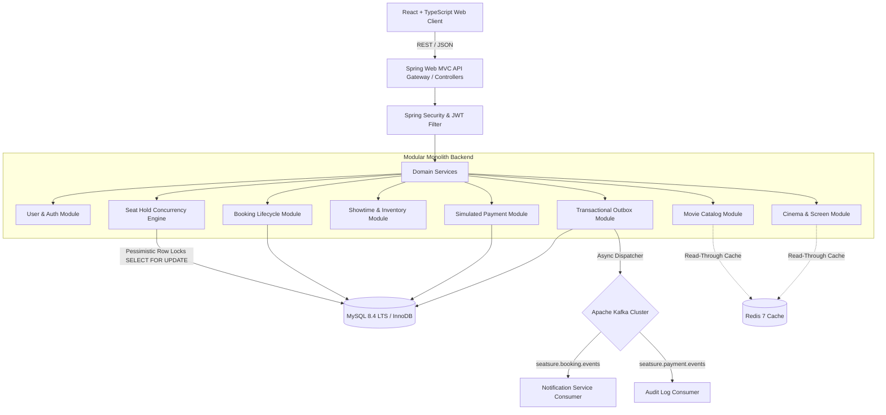

# SeatSure — Architecture & Engineering Design

## 1. System Philosophy
SeatSure is architected as a **modular monolith** with clean module boundaries, explicit transaction management, domain event publishing via the Transactional Outbox pattern, and deterministic concurrency control against inventory double-booking.



---

## 2. Layered Component Boundaries

### 2.1 API / Web Layer (`com.seatsure.*.*Controller`)
- **Thin Controllers**: Controllers never contain business rules or transaction management. They validate request DTOs (`@Valid`), extract authentication credentials via `SecurityUtils`, and delegate to domain services.
- **Envelope Standardization**: Every HTTP response is wrapped in `ApiResponse<T>`, providing uniform status codes, error codes, and request timestamps.
- **Privacy Preservation**: Public endpoints never leak private user identifiers, internal hold identifiers, or other customers' reservation references.

### 2.2 Service Layer (`com.seatsure.*.*Service`)
- Encapsulates domain logic, validation rules, state machine transitions, and database transactions.
- Declares explicit transaction boundaries using `@Transactional(isolation = Isolation.READ_COMMITTED)`.
- Writes domain events directly into the `outbox_events` table within the same database transaction.

### 2.3 Persistence Layer (`com.seatsure.*.*Repository`)
- Standard Spring Data JPA interfaces paired with custom pessimistic write queries (`@Lock(LockModeType.PESSIMISTIC_WRITE)`).
- Strict isolation from API consumers: Entity classes are never serialized directly in API responses.

---

## 3. Concurrency & Inventory Guarantees
- **Authoritative Source of Truth**: MySQL InnoDB is the sole authoritative authority for physical inventory and seat availability. Redis is used solely for metadata acceleration and listings.
- **Deadlock-Free Row-Level Locking**: When acquiring a hold across multiple seats, the seat identifiers are sorted in ascending order (`ORDER BY seat_id ASC`) prior to issuing `SELECT ... FOR UPDATE`. This guarantees a deterministic lock hierarchy and eliminates cyclic deadlocks.
- **Atomic State Transitions**:
  ```
  AVAILABLE  ----[ POST /holds ]----> HELD (with TTL)
  HELD       ----[ POST /payments ]--> BOOKED
  HELD       ----[ Expired/Declined ]-> AVAILABLE
  BOOKED     ----[ Cancelled ]-------> AVAILABLE
  ```

---

## 4. Message Reliability: Transactional Outbox
Directly calling Kafka producers within a database transaction violates atomicity: if the database transaction rolls back after the message was sent, consumers process phantom events (Dual-Write problem).

SeatSure solves this using the **Transactional Outbox Pattern**:
1. The business record (e.g., `Booking`, `Payment`) and the `OutboxEvent` record are persisted in the **same database transaction**.
2. A scheduled worker polls `outbox_events` where `published = false` ordered by `created_at ASC`.
3. The event is dispatched to Kafka (or Spring Event Bus in local mode).
4. Only upon successful acknowledgment is `published` updated to `true`.
5. Consumer groups (`NotificationConsumer`, `AuditConsumer`) record the `(event_id, consumer_group)` composite key in the `processed_events` table to achieve **idempotent message processing**.
