# SeatSure — Double-Booking Prevention & Concurrency Architecture

## 1. The Core Engineering Challenge
In ticket booking platforms like BookMyShow, high contention occurs when thousands of customers attempt to reserve the same popular seats simultaneously upon release. 

A naive approach using application-level checks or standard `SELECT` queries before `INSERT` fails due to **Read-Modify-Write Race Conditions** and **Phantom Reads**:

```
User A: SELECT status FROM show_seats WHERE id = 10 -> 'AVAILABLE'
User B: SELECT status FROM show_seats WHERE id = 10 -> 'AVAILABLE'
User A: UPDATE show_seats SET status = 'HELD' WHERE id = 10; -> SUCCESS
User B: UPDATE show_seats SET status = 'HELD' WHERE id = 10; -> OVERWRITES User A! (DOUBLE-BOOKING)
```

---

## 2. Selected Strategy: Deterministic Pessimistic Row Locking

SeatSure guarantees 100% zero double-booking using **Pessimistic Row-Level Locking (`SELECT ... FOR UPDATE`) with Deterministic Ordering** under `READ_COMMITTED` isolation.

### 2.1 Why Pessimistic Locking over Pure Optimistic Locking?
- In high-contention flash sales (e.g., premier movie releases), optimistic locking causes excessive rollback storms and repeated transaction retries as version conflicts spike exponentially.
- Pessimistic locking acquires exclusive row-level mutexes on the candidate seats at the beginning of the transaction, ensuring clean serializability for contested inventory.

### 2.2 Deadlock Prevention: Deterministic Lock Hierarchy
When multiple seats are requested in a single transaction (e.g. Seats 5, 8, 12), concurrent requests acquiring locks in arbitrary orders can cause cyclic deadlocks:

```
Transaction 1: Locks Seat 5 -> Waiting to lock Seat 8
Transaction 2: Locks Seat 8 -> Waiting to lock Seat 5  ====> DEADLOCK!
```

**SeatSure's Solution**:
Every hold request explicitly sorts requested physical seat IDs in natural ascending order before issuing the query:

```java
List<Long> sortedSeatIds = requestedSeatIds.stream().distinct().sorted().toList();
List<ShowSeat> showSeats = showSeatRepository.findByShowIdAndSeatIdInForUpdate(showId, sortedSeatIds);
```

Because all transactions acquire locks in the exact same resource order (`Seat 5` then `Seat 8`), cyclic wait graphs are mathematically impossible.

---

## 3. Reservation & Concurrency Sequence

```mermaid
sequenceDiagram
    autonumber
    actor CustomerA as Customer A (Winner)
    actor CustomerB as Customer B (Competitor)
    participant HoldService as SeatHoldService
    participant DB as MySQL InnoDB (show_seats)
    participant Scheduler as HoldExpirationScheduler

    CustomerA->>HoldService: POST /holds (Seat 10)
    CustomerB->>HoldService: POST /holds (Seat 10)
    
    rect rgb(20, 30, 50)
        Note over HoldService,DB: Transaction 1 begins
        HoldService->>DB: SELECT * FROM show_seats WHERE id = 10 FOR UPDATE
        DB-->>HoldService: Row locked exclusively by Transaction 1
    end

    rect rgb(40, 20, 20)
        Note over HoldService,DB: Transaction 2 begins
        HoldService->>DB: SELECT * FROM show_seats WHERE id = 10 FOR UPDATE
        Note over DB: Transaction 2 BLOCKS waiting for row lock
    end

    HoldService->>DB: Verify status == AVAILABLE (TRUE)
    HoldService->>DB: INSERT INTO seat_holds (status = 'ACTIVE', expires_at = NOW() + 5m)
    HoldService->>DB: UPDATE show_seats SET status = 'HELD', current_hold_id = 101 WHERE id = 10
    Note over HoldService,DB: Transaction 1 COMMITS (Lock Released)
    HoldService-->>CustomerA: 201 Created (Hold #101 Acquired)

    Note over DB: Transaction 2 acquires lock on Seat 10
    DB-->>HoldService: Returns Seat 10 (status = 'HELD')
    HoldService->>HoldService: Verify status == AVAILABLE (FALSE!)
    Note over HoldService,DB: Transaction 2 ROLLS BACK
    HoldService-->>CustomerB: 409 Conflict (SeatUnavailableException)
```



---

## 4. Race Condition Analysis: Late Payment vs. Hold Expiration

### The Scenario
Customer holds Seat 10 with a 5-minute expiry. At minute 05:00.01, the user's payment clears at the payment provider, but the `SeatHoldExpirationScheduler` runs simultaneously to release expired holds.

### SeatSure's Safe Compensation Policy
When confirming payment in `PaymentService.processPayment`:
1. The service begins an isolated transaction and locks the `Booking` and the associated `ShowSeat` inventory (`SELECT ... FOR UPDATE`).
2. It evaluates whether the seats remain validly held for this booking:
   ```java
   boolean anySeatUnavailable = showSeats.stream()
       .anyMatch(ss -> ss.getStatus() == ShowSeatStatus.BOOKED);
   
   if (anySeatUnavailable || booking.isExpired()) {
       // Safe Compensation Policy
       payment.setStatus(PaymentStatus.REFUND_PENDING);
       payment.setFailureReason("HOLD_EXPIRED_AUTO_REFUND");
       // Never confirm an unavailable seat!
   }
   ```
3. If the seats were already seized by another customer, the payment **never confirms double-booking**. Instead, it transitions to `REFUND_PENDING` / `REFUNDED` and alerts the customer with an automatic full refund.
4. If the seats are still unallocated, the booking is safely confirmed and inventory transitioned to `BOOKED`.

---

## 5. Verification Against Automated Multi-Threaded Tests
SeatSure includes an automated test (`SeatHoldConcurrencyIntegrationTest.java`) that launches **10 concurrent threads** targeting the exact same seat at the same microsecond using a `CountDownLatch`.

Results:
- Exactly 1 thread succeeds (status `201 CREATED`).
- Exactly 9 competing threads receive `409 CONFLICT` (`SeatUnavailableException`).
- Zero duplicate holds and zero corrupted inventory.
