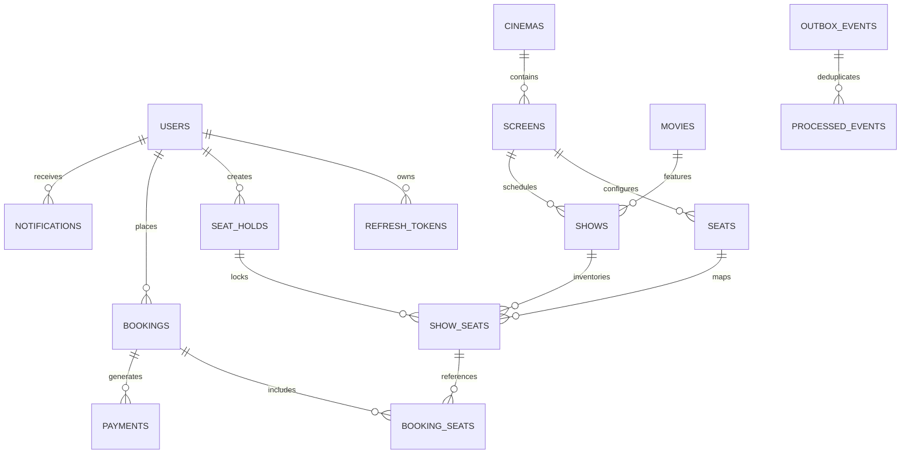

# SeatSure — Database Architecture & Schema Specification

## 1. Entity Relationship (ER) Diagram



---

## 2. Table Schemas & Engineering Rationale

### `users`
| Column | Type | Constraints | Description |
|---|---|---|---|
| `id` | BIGINT | PRIMARY KEY, AUTO_INCREMENT | Unique user identifier |
| `name` | VARCHAR(100) | NOT NULL | Full user name |
| `email` | VARCHAR(150) | NOT NULL, UNIQUE | User login email (case-insensitive) |
| `password_hash` | VARCHAR(255) | NOT NULL | BCrypt hashed password |
| `role` | VARCHAR(20) | NOT NULL | Role: `ROLE_CUSTOMER`, `ROLE_ADMIN`, `ROLE_SYSTEM` |
| `enabled` | BOOLEAN | NOT NULL DEFAULT TRUE | Account activation state |
| `created_at` | TIMESTAMP | NOT NULL DEFAULT CURRENT_TIMESTAMP | UTC account creation timestamp |
| `updated_at` | TIMESTAMP | NOT NULL DEFAULT CURRENT_TIMESTAMP | UTC modification timestamp |

### `movies`
| Column | Type | Constraints | Description |
|---|---|---|---|
| `id` | BIGINT | PRIMARY KEY, AUTO_INCREMENT | Unique movie identifier |
| `title` | VARCHAR(255) | NOT NULL | Movie title |
| `description` | TEXT | NULL | Movie synopsis |
| `duration_minutes` | INT | NOT NULL | Running time in minutes |
| `language` | VARCHAR(50) | NOT NULL | Audio language |
| `genre` | VARCHAR(50) | NOT NULL | Primary genre |
| `release_date` | DATE | NOT NULL | Release date |
| `poster_url` | VARCHAR(500) | NULL | High-resolution image URL |
| `content_rating` | VARCHAR(10) | NOT NULL DEFAULT 'UA' | Certification (e.g. U, UA, A) |
| `status` | VARCHAR(20) | NOT NULL DEFAULT 'ACTIVE' | Catalog status: `ACTIVE`, `INACTIVE` |

### `cinemas` & `screens`
- `cinemas`: Represents physical theater multiplexes with name, address, and city (`Mumbai`, `Bengaluru`, `Delhi NCR`, `Hyderabad`).
- `screens`: Represents auditoriums inside a cinema with screen name, total capacity, and foreign key to `cinemas(id)`.

### `seats`
- Represents physical seats installed within a screen.
- Columns: `id`, `screen_id`, `row_label` (e.g., 'A', 'B'), `seat_number` (e.g., 1, 2), `seat_type` (`SILVER`, `GOLD`, `PLATINUM`), `status`.
- **Unique Constraint**: `uk_screen_row_seat (screen_id, row_label, seat_number)` prevents duplicate physical seat registrations.

### `shows`
- Schedules a specific movie screening in a screen at a defined `start_time` and `end_time` with a `base_price`.
- Application-level transactional protection prevents overlapping shows in the same auditorium:
  ```sql
  SELECT s FROM Show s WHERE s.screen.id = :screenId AND s.status = 'SCHEDULED'
  AND s.startTime < :endTime AND s.endTime > :startTime;
  ```

### `show_seats` (The Inventory Pivot)
- Represents the booking inventory for a specific physical seat at a specific scheduled show.
- Columns:
  - `id`: BIGINT PK
  - `show_id`: FK to `shows(id)`
  - `seat_id`: FK to `seats(id)`
  - `price`: DECIMAL(10,2) (Tier calculated: Silver = base, Gold = 1.4x, Platinum = 2.0x)
  - `status`: `AVAILABLE`, `HELD`, `BOOKED`
  - `current_hold_id`: BIGINT NULL, FK to `seat_holds(id)`
  - `version`: BIGINT NOT NULL DEFAULT 0 (Optimistic concurrency version)
- **Unique Constraint**: `uk_show_seat (show_id, seat_id)` guarantees one inventory row per physical seat per show.
- **Index**: `idx_show_seats_status (show_id, status)` for rapid availability searches.

### `seat_holds`
- Tracks temporary reservations held while customer proceeds through checkout.
- Columns: `id`, `user_id`, `show_id`, `status` (`ACTIVE`, `CONFIRMED`, `EXPIRED`, `RELEASED`), `created_at`, `expires_at`, `released_at`.

### `bookings` & `booking_seats`
- `bookings`: Represents customer ticket orders with unique human-readable `booking_reference` (e.g., `BK-A4C9812E`), `total_amount` (authoritative server-calculated `DECIMAL(10,2)`), currency `INR`, and lifecycle `status` (`PENDING`, `CONFIRMED`, `PAYMENT_FAILED`, `EXPIRED`, `CANCELLED`).
- `booking_seats`: Bridge table linking `booking_id` and `show_seat_id` with `price_at_booking`. Unique constraint on `(booking_id, show_seat_id)`.

### `payments`
- Records payment transactions with strict idempotency and audit references.
- Columns: `id`, `booking_id`, `payment_reference` (UNIQUE), `idempotency_key` (UNIQUE), `amount`, `status` (`INITIATED`, `SUCCESS`, `FAILED`, `REFUND_PENDING`, `REFUNDED`), `provider_reference`, `failure_reason`.

### `outbox_events` & `processed_events`
- `outbox_events`: Implements transactional outbox pattern. Columns: `id` (UUID), `aggregate_type`, `aggregate_id`, `event_type`, `payload` (JSON), `published` (BOOLEAN), `published_at`, `retry_count`.
- `processed_events`: Deduplication table for consumer groups. Primary Key: `(event_id, consumer_group)`.
