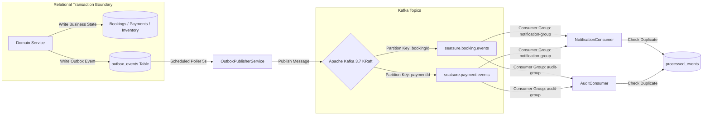

# SeatSure — Asynchronous Events, Outbox & Failure Recovery

## 1. Event-Driven Architecture Overview

SeatSure decouples transactional booking state from notification delivery, audit logging, and external reporting via **Apache Kafka** and the **Transactional Outbox Pattern**.



---

## 2. Kafka Topics & Partitioning Strategy

| Topic Name | Partitions | Partition Key | Aggregate Events |
|---|---|---|---|
| `seatsure.booking.events` | 3 | `bookingId` | `BookingCreated`, `BookingConfirmed`, `BookingCancelled` |
| `seatsure.payment.events` | 3 | `paymentId` | `PaymentSucceeded`, `PaymentFailed` |
| `seatsure.seat.events` | 3 | `showId` | `SeatHoldCreated`, `SeatHoldReleased`, `SeatHoldExpired` |
| `seatsure.booking.events.DLT` | 1 | `bookingId` | Dead-letter storage for unparseable poison messages |

### Why Partition by Aggregate ID?
Kafka guarantees strict FIFO ordering **within a single partition**. By using the aggregate ID (`bookingId` or `showId`) as the Kafka message key, all events pertaining to a specific booking always land on the exact same partition in chronological order. Consumers never receive `BookingConfirmed` before `BookingCreated`.

---

## 3. Idempotent Consumer Pattern (At-Least-Once Delivery)
Because distributed networks can duplicate messages during retries, consumers cannot rely on Kafka for exactly-once database state.

SeatSure consumers implement **Consumer Deduplication** via the `processed_events` table:

```java
if (processedEventRepository.existsByEventIdAndConsumerGroup(event.getEventId(), CONSUMER_GROUP)) {
    log.debug("Event {} already processed by {}, skipping", event.getEventId(), CONSUMER_GROUP);
    return;
}

// 1. Process side effects (e.g., generate user notification)
// 2. Mark event as processed in database
processedEventRepository.save(new ProcessedEvent(event.getEventId(), CONSUMER_GROUP));
```

---

## 4. Failure Modes & Autonomous Recovery

### 4.1 Scenario A: Kafka Broker is Down
- **Behavior**: The business transaction commits without interruption. The event is safely stored in `outbox_events` with `published = false`.
- **Recovery**: `OutboxPublisherService` encounters an error, increments `retry_count`, and waits for the next polling cycle. Once the broker comes back online, all pending outbox events are automatically dispatched in order.

### 4.2 Scenario B: Redis Cache Unavailable
- **Behavior**: If Redis is unreachable, SeatSure's resilient cache fallback (`fallbackCacheManager`) transparently falls back to direct database reads or in-memory caches.
- **Rule**: MySQL remains the authoritative source of truth. A Redis cache failure never blocks seat booking or payment processing.

### 4.3 Scenario C: Client Abandonment (Browser Closed Mid-Checkout)
- **Behavior**: If a customer holds seats and abruptly closes their browser without paying, the hold remains active until its configured TTL (default 5 minutes).
- **Recovery**: `SeatHoldExpirationScheduler` runs periodically (every 10 seconds), identifies active holds where `expires_at <= NOW()`, atomically sets `status = 'EXPIRED'`, restores `show_seats.status = 'AVAILABLE'`, and clears the hold reference.
